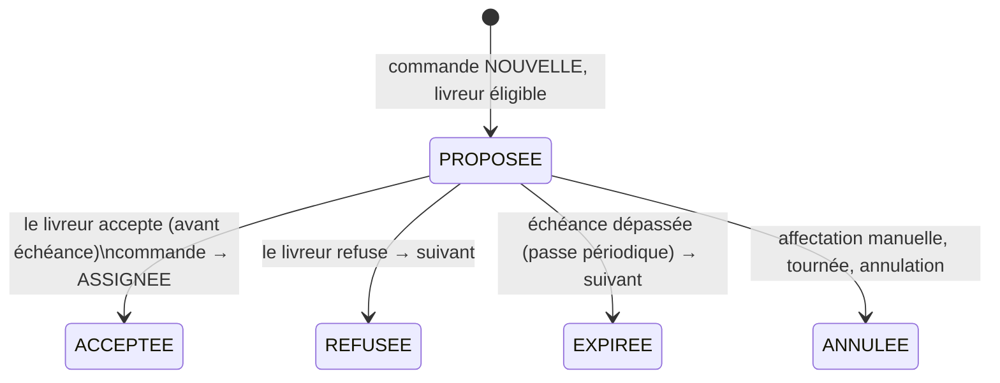

# ADR 0004 — Affectation automatique équitable avec acceptation du livreur

Date : 2026-10-18 · Statut : accepté

## Contexte
Aucune commande ne partait seule. `GET /v1/dispatch/suggest/:ref` classait les livreurs
disponibles sur 100 points (zone 40/15 par ville, disponibilité 30, charge 30 − 10 par course
active) pour qu'un humain clique ; toute commande restait `NOUVELLE` jusqu'à
`POST /v1/orders/:ref/assign`. Le dispatcher passait sa journée à affecter des courses qui ne
posaient aucune question.

Décisions produit (propriétaire, définitives) : un interrupteur d'entreprise, désactivé par
défaut ; **équité** et non « le meilleur score rafle tout » ; acceptation du livreur dans un
délai ; le dispatcher ne traite que les **exceptions**, avec un motif explicite ; tout est
journalisé ; l'affectation manuelle reste toujours possible.

## Décision

### Réglages (`company_settings`, migration 0029)
| Réglage | Défaut | Bornes | Qui |
|---|---|---|---|
| `auto_dispatch` (interrupteur) | `false` | — | ADMIN |
| `offer_timeout_min` (délai d'acceptation) | 3 | 1..60 min | ADMIN |
| `default_daily_capacity` | 20 | 1..500 commandes/jour | ADMIN |
| `drivers.daily_capacity` (par livreur) | `NULL` = défaut | 1..500 | ADMIN (page Chauffeurs) |

### Éligibilité et équité (`planAutoDispatch`, `packages/domain`, règle pure testée)
Un livreur est **éligible** pour une commande si, dans cet ordre (le premier filtre vide donne
le motif d'exception) :
1. **sa zone couvre le point de retrait** — point dans le polygone de la zone quand la commande a
   des coordonnées de retrait et la zone un polygone ; sinon correspondance de ville (province,
   commune, ou nom composant la région). Un livreur sans zone n'est jamais sollicité.
   → sinon `ZONE_NON_COUVERTE` ;
2. il est **disponible**, a un **compte d'app livreur actif** (« non suspendu » : sans compte
   actif, personne ne peut accepter), **permis et visite médicale valides** (échéance ≥ aujourd'hui).
   → sinon `AUCUN_LIVREUR_DISPONIBLE` ;
3. il n'a **pas déjà refusé ou laissé expirer** la proposition dans le tour courant.
   → sinon `REFUSEE_PAR_TOUS` ;
4. sa **charge du jour est sous sa capacité**. Charge = commandes affectées aujourd'hui
   (`orders.assigned_at` dans la journée du fuseau de l'entreprise, Africa/Casablanca par
   défaut, hors annulées) **+ propositions en cours**. → sinon `CAPACITE_ATTEINTE`.

Parmi les éligibles : **le moins chargé au regard de sa capacité** (`charge / capacité`
croissant) ; à égalité, le plus proche du retrait (distance haversine depuis sa **dernière
position GPS** ; position connue avant inconnue) ; puis le nom (ordre déterministe).

Le score /100 de `suggest` est conservé tel quel pour le dialogue d'affectation manuelle : ce
sont deux usages différents (aide à la décision humaine vs répartition automatique).

### État « proposée » : table `order_offers`, statut de commande inchangé
La commande **reste `NOUVELLE`** tant que personne n'a accepté. L'énumération `OrderStatus` est
partagée par toutes les apps et le suivi public (skill `transpo-domain` : ne jamais la
diverger) ; y ajouter un statut aurait touché le suivi client, les badges, la machine d'états
et les apps mobiles pour un état qui dure trois minutes. La proposition vit à côté :

`order_offers(id, ref, driver, round, status, reason, offered_at, expires_at, responded_at)`.
`orders` gagne `assigned_at`, `dispatch_exception` (+ `_at`) et `dispatch_round`. Une **relance**
par le dispatcher ouvre un nouveau tour : les refus du tour précédent ne comptent plus.
Les exceptions restent posées jusqu'à une relance ou une affectation (manuelle ou tournée) :
l'automate ne réessaie pas seul une commande qu'il a déjà remise à un humain.

### Déclencheurs et passe périodique
- Création d'une commande `NOUVELLE`, et passage `PROGRAMMEE → NOUVELLE` (programmée arrivée
  à échéance) → placement immédiat.
- Refus → placement du suivant immédiatement.
- Passe périodique dans le processus API (`AUTO_DISPATCH_INTERVAL_MS`, 15 s par défaut, `0`
  la désactive) : expire les propositions échues et propose au suivant, retire les propositions
  devenues sans objet, et **rattrape** les commandes `NOUVELLE` sans proposition ni exception
  (API redémarrée, interrupteur fraîchement activé). `POST /v1/dispatch/auto/run` exécute la
  même passe à la demande.

### Sûreté à plusieurs répliques (aucune double affectation)
- Placement : transaction + `pg_try_advisory_xact_lock(hashtext(schéma:dispatch:ref))` — une
  réplique qui n'obtient pas le verrou passe son tour ; `SELECT … FOR UPDATE` sur la commande.
- **Index unique partiel** `order_offers(ref) WHERE status = 'PROPOSEE'` : au plus une
  proposition en cours par commande, quelle que soit la réplique (violation → ignorée).
- Expiration : `UPDATE order_offers … WHERE status = 'PROPOSEE' AND expires_at < now() RETURNING`,
  journalisée dans la même instruction (CTE) — chaque proposition échue n'est rendue qu'une fois.
- Acceptation : proposition verrouillée (`FOR UPDATE`), contrôle d'échéance côté serveur, puis
  `UPDATE orders … WHERE driver IS NULL AND status = 'NOUVELLE'` ; rien de modifié → 409.

### Journal (`order_events`) et notifications
Faits écrits au journal de la commande (acteur `NULL` = automate) : `OFFRE_PROPOSEE` (livreur,
charge/capacité, distance, rang), `ASSIGNEE` (« Proposition acceptée »), `OFFRE_REFUSEE`,
`OFFRE_EXPIREE`, `OFFRE_ANNULEE`, `EXCEPTION_DISPATCH` (motif), `RELANCE_DISPATCH`. Ce ne sont
pas des statuts de commande : la console les libelle via `DISPATCH_EVENT_META`.
- Livreur : push OneSignal `driver.offer` (données `{ type: 'offer', ref, offerId }` : la toucher
  ouvre l'écran Missions) ; `driver.assigned` inchangé pour l'affectation manuelle.
- Exploitation : nouveau canal `CONSOLE` (notification interne, `notifications` du tenant) pour
  `dispatch.exception`, affichée par la cloche de la console et le centre de notifications. Les
  dispatchers n'ont aucun appareil enregistré pour le push : pas de push dispatcher.

## Endpoints et droits
| Endpoint | Rôles |
|---|---|
| `GET /v1/dispatch/settings` | ADMIN, DISPATCHER, COMPTABLE |
| `PUT /v1/dispatch/settings` | ADMIN |
| `GET /v1/dispatch/exceptions`, `GET /v1/dispatch/offers`, `GET /v1/dispatch/offers/:ref` | ADMIN, DISPATCHER |
| `POST /v1/dispatch/auto/:ref/retry`, `POST /v1/dispatch/auto/run` | ADMIN, DISPATCHER |
| `PATCH /v1/drivers/:id` (`dailyCapacity`) | ADMIN |
| `GET /v1/driver/offers`, `POST /v1/driver/offers/:id/accept`, `…/refuse` | DRIVER (ses propositions uniquement) |

Accepter/refuser est **idempotent par nature** (rejouer la même décision rend le même
résultat) ; l'app livreur les passe par sa file hors ligne avec une `Idempotency-Key` stable.
Une acceptation rejouée après l'échéance reçoit 409 : le serveur fait foi.

## Conséquences
- Le dispatcher arrive sur l'onglet **Exceptions** quand l'automate est actif ; badge rouge sur
  l'entrée Dispatch et sur la cloche.
- Une proposition en cours compte dans la charge : un livreur ne reçoit pas plus de propositions
  simultanées que sa capacité restante.
- Les commandes antérieures (sans `assigned_at`) ne pèsent pas sur la capacité du jour.

## Limites connues
- Les zones seedées historiquement portent des **initiales** (`YB`, `SI`) dans `zones.drivers` ;
  l'automate rattache par **nom** (la console enregistre des noms depuis la recette E). Une zone
  aux initiales doit être réenregistrée depuis la page Zones pour que ses livreurs soient sollicités.
- Un livreur qui se met indisponible garde ses propositions en cours jusqu'à refus ou échéance.
- Pas de test E2E navigateur/Maestro de l'écran ; le push réel sur appareil n'a pas été vérifié
  dans ce lot (OneSignal non configuré en local).
